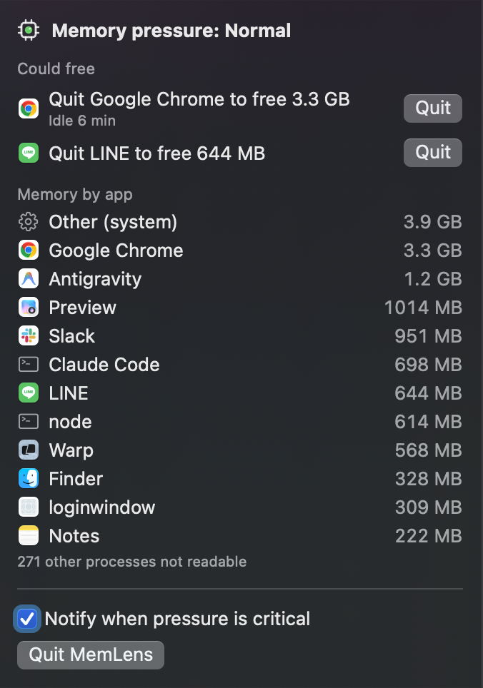

# MemLens

A macOS menu bar app for people who run local AI models. It shows how much
memory pressure your Mac is under, which apps and processes are using the
memory, and which app to quit for the biggest win.

<p align="center">
  
</p>

## Install

With [Homebrew](https://brew.sh):

```sh
brew install --cask kyoangel/tap/memlens
```

Or download `MemLens-<version>.dmg` from the
[latest release](https://github.com/kyoangel/memlens/releases/latest), open it and drag
MemLens to Applications.

MemLens is signed with a Developer ID and notarized by Apple, so it opens without
Gatekeeper warnings.

## Requirements

- macOS 14 Sonoma or later
- Apple Silicon (M1 or later)

## Privacy

MemLens makes no network connections and collects no analytics. It reads memory
figures from macOS on your Mac. The only thing it stores is whether
critical-pressure notifications are turned on.

## What you see

- **Menu bar icon**: a memory chip with a lens. The chip follows the menu bar color;
  the lens shows memory pressure: green (normal), orange (warning), red (critical).
- **Could free / Quit to free memory**: up to 5 apps it suggests quitting, with how
  much each would free and how long it has been idle.
- **Memory by app**: the top memory users. Helper processes are merged into their
  app (all Chrome helpers count as "Google Chrome"), and system daemons are pooled
  into "Other (system)". Python processes are listed one by one, labelled with the
  model they have loaded when MemLens can detect it ("Python · FLUX.1-schnell").

## When does MemLens suggest quitting an app?

MemLens is deliberately conservative. A suggestion that kills your work is worse
than no suggestion, so an app is suggested only when **all five** of these hold:

| # | Rule | Why |
|---|------|-----|
| 1 | It is a regular Dock app. | Menu bar utilities, background agents and command-line processes (`node`, `python`, Claude Code, …) may be doing work you cannot see. Quitting them could kill a training run or a server, so they are listed but never suggested. |
| 2 | It uses at least **500 MB** (counting all its helpers). | Quitting a small app costs you more (relaunching, lost state) than the memory it gives back. |
| 3 | It is not the frontmost app. | You are using it right now. |
| 4 | It has not been used in the last **2 minutes**. | Switching away for a moment does not make an app idle. |
| 5 | It is not a built-in macOS app under `/System/` (Safari, Notes, Finder, …). | These are part of the system experience, and some relaunch themselves anyway. |

MemLens itself is never suggested.

### Ranking

Apps that pass all five rules are ranked by:

```
score = memory footprint × (1 + idle hours, capped at 4)
```

A big app you have not touched in hours ranks above a slightly bigger app you
used ten minutes ago. When MemLens cannot tell how long an app has been idle,
the app is ranked by size alone and is never treated as long-idle.

### Quitting

The **Quit** button asks the app to quit the normal way, as if you had pressed ⌘Q.
The app can still ask you to save your work. MemLens never force-quits from a
suggestion.

## How processes are named

- Apps use their bundle name and their own icon, as in Activity Monitor.
- Python processes are named "Python" (plus the detected model) with a chip icon.
- System daemons are pooled into "Other (system)" with a gear icon.
- Other command-line tools use their executable name with a terminal icon. Some tools
  install as a file named only by its version (Claude Code lives at
  `~/.local/share/claude/versions/2.1.322`). For these, MemLens uses the tool's
  directory name instead, so all running versions merge into one row. Known tools
  get their product name ("Claude Code"), so they are not confused with the
  similarly named desktop app ("Claude").

## Build from source

MemLens builds with SwiftPM and the Command Line Tools. Xcode is not required.

```sh
swift test              # run the test suite
./scripts/bundle.sh     # build an ad-hoc signed build/MemLens.app
open build/MemLens.app
```

## Releasing

`scripts/release.sh <version>` builds `build/MemLens-<version>.dmg`, signed with a
Developer ID Application certificate, notarized by Apple and stapled, and prints its
SHA-256 (also written to `build/MemLens-<version>.dmg.sha256`). The script runs `swift test`
first. The DMG is arm64 only.

One-time setup:

1. Install a **Developer ID Application** certificate in the login keychain.
2. Create an app-specific password for your Apple ID.
3. Store notarization credentials in the keychain (the password is prompted for):

   ```sh
   xcrun notarytool store-credentials memlens-notary --apple-id <apple-id> --team-id <TEAMID>
   ```

Overrides: `MEMLENS_SIGN_IDENTITY`, `MEMLENS_NOTARY_PROFILE`, `MEMLENS_SKIP_NOTARIZE=1`. To test the pipeline
without a certificate: `MEMLENS_SIGN_IDENTITY=- MEMLENS_SKIP_NOTARIZE=1 scripts/release.sh 0.1.0`
(the result is not distributable).

The app icon is generated from `Resources/AppIcon.svg` with `scripts/make-icon.sh`
(needs `brew install librsvg`); the generated `Resources/AppIcon.icns` is committed.

Publishing a release:

```sh
gh release create v<version> build/MemLens-<version>.dmg build/MemLens-<version>.dmg.sha256 \
  --title "MemLens <version>" --notes-file <notes.md>
```

Then update `version` and `sha256` in `Casks/memlens.rb` in
[kyoangel/homebrew-tap](https://github.com/kyoangel/homebrew-tap) and push.

## License

MIT. See [LICENSE](LICENSE).
